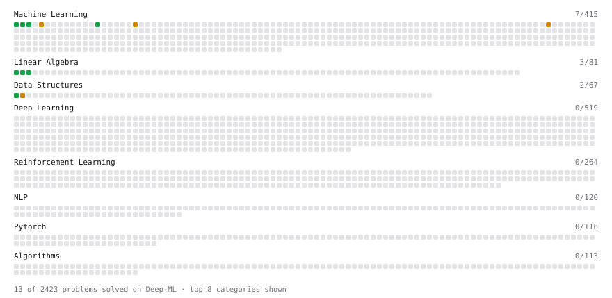

# Deep-ML

My machine learning practice from [Deep-ML](https://www.deep-ml.com). Every solution here was written by hand.

**29** solved · 29 problems · 0 labs · 0 math

[**Browse the interactive portfolio**](https://Akruman7256.github.io/deep-ml/) to replay this filling in over time.

## Problems

| | Difficulty | Solved | |
| --- | --- | --- | --- |
| [Backprop a Linear Layer by Hand](https://www.deep-ml.com/problems/898) | easy | 2026-09-04 | [solution](problems/0898-backprop-a-linear-layer-by-hand) |
| [Build a Dataset and Use It with a DataLoader](https://www.deep-ml.com/problems/899) | easy | 2026-08-24 | [solution](problems/0899-build-a-dataset-and-use-it-with-a-dataloader) |
| [Build a Linear Regression Model with nn.Module](https://www.deep-ml.com/problems/885) | easy | 2026-08-24 | [solution](problems/0885-build-a-linear-regression-model-with-nn-module) |
| [Calculate Root Mean Square Error (RMSE)](https://www.deep-ml.com/problems/71) | easy | 2026-09-07 | [solution](problems/0071-calculate-root-mean-square-error-rmse) |
| [Compute PSNR for Image Reconstruction Quality](https://www.deep-ml.com/problems/713) | easy | 2026-08-30 | [solution](problems/0713-compute-psnr-for-image-reconstruction-quality) |
| [Convert Vector to Diagonal Matrix](https://www.deep-ml.com/problems/35) | easy | 2026-09-17 | [solution](problems/0035-convert-vector-to-diagonal-matrix) |
| [Create a Float Tensor from a Python List](https://www.deep-ml.com/problems/880) | easy | 2026-08-22 | [solution](problems/0880-create-a-float-tensor-from-a-python-list) |
| [Derivative of a Polynomial](https://www.deep-ml.com/problems/116) | easy | 2026-07-24 | [solution](problems/0116-derivative-of-a-polynomial) |
| [Feature Scaling Implementation](https://www.deep-ml.com/problems/16) | easy | 2026-07-26 | [solution](problems/0016-feature-scaling-implementation) |
| [Implement Hinge Loss for SVM](https://www.deep-ml.com/problems/283) | easy | 2026-09-02 | [solution](problems/0283-implement-hinge-loss-for-svm) |
| [Linear Regression Using Gradient Descent](https://www.deep-ml.com/problems/15) | easy | 2026-08-16 | [solution](problems/0015-linear-regression-using-gradient-descent) |
| [Linear Regression Using Normal Equation](https://www.deep-ml.com/problems/14) | easy | 2026-08-16 | [solution](problems/0014-linear-regression-using-normal-equation) |
| [Matrix-Vector Dot Product](https://www.deep-ml.com/problems/1) | easy | 2026-08-11 | [solution](problems/0001-matrix-vector-dot-product) |
| [Min-Max Scaling of Feature Values](https://www.deep-ml.com/problems/112) | easy | 2026-08-18 | [solution](problems/0112-min-max-scaling-of-feature-values) |
| [One-Hot Encoding of Nominal Values](https://www.deep-ml.com/problems/34) | easy | 2026-08-01 | [solution](problems/0034-one-hot-encoding-of-nominal-values) |
| [Random Shuffle of Dataset](https://www.deep-ml.com/problems/29) | easy | 2026-08-21 | [solution](problems/0029-random-shuffle-of-dataset) |
| [Reshape and Transpose a Tensor](https://www.deep-ml.com/problems/881) | easy | 2026-08-24 | [solution](problems/0881-reshape-and-transpose-a-tensor) |
| [Reshape Matrix](https://www.deep-ml.com/problems/3) | easy | 2026-08-11 | [solution](problems/0003-reshape-matrix) |
| [Transpose of a Matrix](https://www.deep-ml.com/problems/2) | easy | 2026-08-11 | [solution](problems/0002-transpose-of-a-matrix) |
| [Bernoulli Naive Bayes Classifier](https://www.deep-ml.com/problems/140) | medium | 2026-09-02 | [solution](problems/0140-bernoulli-naive-bayes-classifier) |
| [Cross-Validated Prediction with K-Fold Linear Regression](https://www.deep-ml.com/problems/839) | medium | 2026-08-21 | [solution](problems/0839-cross-validated-prediction-with-k-fold-linear-regression) |
| [Handle Missing Data with Imputation](https://www.deep-ml.com/problems/354) | medium | 2026-08-03 | [solution](problems/0354-handle-missing-data-with-imputation) |
| [Implement Gradient Descent Variants with MSE Loss](https://www.deep-ml.com/problems/47) | medium | 2026-08-08 | [solution](problems/0047-implement-gradient-descent-variants-with-mse-loss) |
| [Implement K-Fold Cross-Validation](https://www.deep-ml.com/problems/18) | medium | 2026-08-17 | [solution](problems/0018-implement-k-fold-cross-validation) |
| [Implement K-Nearest Neighbors](https://www.deep-ml.com/problems/173) | medium | 2026-08-25 | [solution](problems/0173-implement-k-nearest-neighbors) |
| [K-Means Clustering](https://www.deep-ml.com/problems/17) | medium | 2026-08-26 | [solution](problems/0017-k-means-clustering) |
| [Principal Component Analysis (PCA) Implementation](https://www.deep-ml.com/problems/19) | medium | 2026-09-10 | [solution](problems/0019-principal-component-analysis-pca-implementation) |
| [Product Rule for Derivatives](https://www.deep-ml.com/problems/309) | medium | 2026-07-24 | [solution](problems/0309-product-rule-for-derivatives) |
| [Decision Tree Learning](https://www.deep-ml.com/problems/20) | hard | 2026-09-15 | [solution](problems/0020-decision-tree-learning) |

---

_This file is regenerated by Deep-ML on every push._
